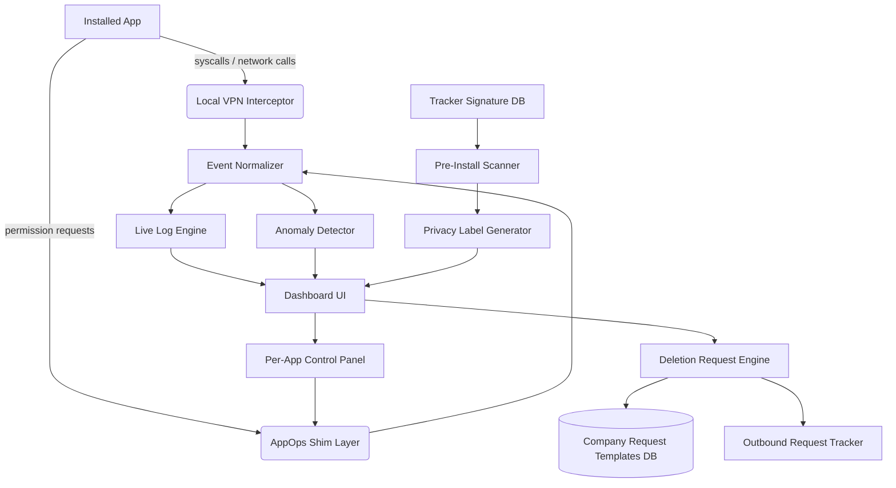

# PrivaCage 🔒
**Know what every app is doing to your device. Right now. In real time.**

A fully open-source, privacy-auditing companion app that scans, monitors, blocks, and reports on every piece of tracking, telemetry, and data collection happening on your device — with a live activity log, pre-install "privacy nutrition labels," granular per-app permission control, and automated GDPR/CCPA data-deletion request generation.

> ⚠️ **Scope note:** On non-rooted devices / stock iOS, PrivaCage operates within OS sandbox limits (it cannot strip manufacturer-level telemetry baked into the OS itself — see [Limitations](#limitations-read-this-first)). On rooted Android / custom ROMs, it goes much deeper.

---

## Table of Contents
- [Features](#features)
- [Architecture](#architecture)
- [Repo Structure](#repo-structure)
- [Core Modules](#core-modules)
- [The Live Log System](#the-live-log-system-normal--cs-mode)
- [Data Flow](#data-flow)
- [Tech Stack](#tech-stack)
- [Legal Request Engine](#legal-request-engine-gdprccpa)
- [Limitations (read this first)](#limitations-read-this-first)
- [Roadmap](#roadmap)
- [Contributing](#contributing)
- [License](#license)

---

## Features

| Feature | Normal explanation | CS yap |
|---|---|---|
| **Live Activity Log** | Shows a running feed of what every app is doing right now — network calls, sensor reads, clipboard grabs | Per-process syscall/API-call interception via `VpnService` (Android) network tunnel + `AccessibilityService`/Xposed hooks (root) logging `connect()`, `getLastKnownLocation()`, `ClipboardManager.getPrimaryClip()`, `Sensor.registerListener()` invocations with timestamp, PID, calling package UID, and destination endpoint |
| **Pre-install Privacy Label** | Before you install an app, see exactly what it *can* access and who it talks to | Static APK analysis: `AndroidManifest.xml` permission extraction, dex bytecode scan against a tracker/SDK signature database (X-Ray/Exodus-style), DNS endpoint extraction from embedded strings/constants |
| **Per-app Permission Toggles** | Flip permissions on/off per app without breaking the app (mostly) | Wraps Android's native `AppOpsManager` + `PackageManager.setComponentEnabledSetting` for granular revocation beyond stock OS granularity; fake/empty data injection for permissions that would crash on hard denial |
| **Network Kill Switch (per-app)** | Block an app from reaching the internet entirely, or just block specific trackers | Local VPN loopback (`VpnService`) intercepting all egress traffic, routing through a per-UID iptables-style ruleset; DNS-level blocklist matching against curated tracker domain lists |
| **Tracker Database** | A constantly updated list of known tracking/ad SDKs | Community-maintained JSON/SQLite signature DB (class name patterns, domain patterns), pollable from a public repo, versioned and diffable |
| **Data Deletion Request Generator** | Auto-fills and sends "delete my data" requests to companies on your behalf | Template engine mapping company → jurisdiction → applicable law (GDPR Art.17, CCPA §1798.105) → auto-generated formal request + tracked submission (email/webform API) + response status tracker |
| **Consent Receipt Ledger** | A timestamped record of every permission grant/revoke you've ever made | Append-only local log (optionally exportable/signed) acting as a personal audit trail, useful as evidence in disputes |
| **Panic Mode** | One tap: kill network on every non-essential app | Bulk `AppOpsManager` + VPN ruleset push, reversible, logged |
| **Anomaly Alerts** | Notifies you if an app starts doing something new/unusual | Baseline-vs-current behavioral diff per app (e.g. app that never touched location starts querying GPS at 3am) |

---

## Architecture



---

## Repo Structure

```
privacage/
├── README.md
├── LICENSE
├── CONTRIBUTING.md
├── docs/
│   ├── architecture.md
│   ├── threat-model.md
│   ├── legal-basis.md              # jurisdiction-by-jurisdiction legal notes
│   └── permission-matrix.md
├── android/
│   ├── app/
│   │   ├── src/main/java/com/privacage/
│   │   │   ├── vpn/                # VpnService-based traffic interceptor
│   │   │   │   ├── PacketInspector.kt
│   │   │   │   ├── DnsBlocklistMatcher.kt
│   │   │   │   └── PerAppRuleRouter.kt
│   │   │   ├── appops/              # permission shim layer
│   │   │   │   ├── PermissionToggleService.kt
│   │   │   │   └── FakeDataInjector.kt
│   │   │   ├── scanner/            # static APK analysis
│   │   │   │   ├── ManifestParser.kt
│   │   │   │   ├── SdkSignatureMatcher.kt
│   │   │   │   └── PrivacyLabelBuilder.kt
│   │   │   ├── log/                # the live log engine (see below)
│   │   │   │   ├── EventNormalizer.kt
│   │   │   │   ├── LogFormatterNormal.kt
│   │   │   │   ├── LogFormatterVerbose.kt
│   │   │   │   └── AnomalyDetector.kt
│   │   │   ├── legal/              # GDPR/CCPA request engine
│   │   │   │   ├── RequestTemplateEngine.kt
│   │   │   │   ├── CompanyRegistry.kt
│   │   │   │   └── SubmissionTracker.kt
│   │   │   └── ui/
│   │   │       ├── DashboardActivity.kt
│   │   │       ├── AppDetailScreen.kt
│   │   │       └── PanicModeFragment.kt
│   │   └── AndroidManifest.xml
│   └── root-extensions/            # optional, root-only deeper hooks
│       ├── xposed-module/
│       └── magisk-module/
├── ios/
│   ├── PrivaCage/
│   │   ├── NetworkExtension/       # NEPacketTunnelProvider-based monitor
│   │   ├── PrivacyReport/          # uses Apple's "App Privacy Report" data
│   │   └── UI/ (SwiftUI)
│   └── README-ios-limitations.md   # what Apple's sandbox blocks you from doing
├── shared/
│   ├── tracker-db/
│   │   ├── signatures.json         # community-maintained tracker/SDK list
│   │   ├── domains-blocklist.txt
│   │   └── schema.md
│   ├── legal-templates/
│   │   ├── gdpr_article17.md
│   │   ├── ccpa_1798_105.md
│   │   └── company-contact-registry.json
│   └── go/
│       └── pcage-tools/           # Go CLI: catalog validation, review report, Android policy gates
├── backend/ (optional sync/cloud features — fully opt-in, E2E encrypted)
│   ├── api/
│   ├── requests-relay/             # proxies deletion requests, no data retention
│   └── docker-compose.yml
└── tests/
    ├── vpn/
    ├── scanner/
    └── legal-engine/
```

---

## Onboarding Flow

First launch walks the user through a two-path setup, then ends on a **Recommended Apps** page.

```
Welcome Screen
      │
      ▼
 ┌─────────────┐        ┌─────────────┐
 │ Recommended │        │  Advanced   │
 │   (1 tap)   │        │ (full control) │
 └──────┬──────┘        └──────┬──────┘
        │                      │
        ▼                      ▼
 Applies curated         User walks through every
 default ruleset:        category manually:
 - block all known       - per-category toggle (ads,
   ad/analytics SDKs       analytics, fingerprinting,
   on sight               location, clipboard, contacts,
 - deny background        crash reporters, A/B test SDKs)
   location + clipboard  - per-app override table
 - auto-send deletion    - choose which data types get
   requests to known       auto flagged for deletion
   major data brokers      requests (location history,
 - CS-mode log OFF         ad ID, purchase history, etc.)
   by default              - choose log verbosity default
        │                      │
        └──────────┬───────────┘
                    ▼
          Recommended Apps Page
```

- **Recommended path** — one tap, applies a maintained "safe defaults" profile (same signature DB, pre-picked conservative rules). Good for non-technical users.
- **Advanced path** — a per-category and per-app configuration screen (`SetupWizardActivity.kt` / `AdvancedConfigScreen.kt`) where the user picks exactly what gets blocked, faked, allowed, or auto-flagged for a deletion request, and sets default log verbosity (Normal/CS).
- Both paths are editable later from Settings → Privacy Rules — nothing here is a one-time irreversible choice.

### Recommended Apps Page
Shown once setup finishes (and always reachable later from the Dashboard). A curated, community-reviewed directory of privacy-respecting alternatives to common mainstream apps, grouped by category, with a one-line reason and a direct install link (F-Droid / Play Store / App Store / direct APK where relevant).

Organized to roughly mirror the Google/Big-Tech app suite, so a user can swap out their whole daily stack one category at a time.

| Category | Google/Big-Tech equivalent | Recommended | Why |
|---|---|---|---|
| Email | Gmail | **Proton Mail**, Tutanota | E2E encrypted, no ad-based scanning of content |
| Cloud storage | Google Drive / iCloud | **Proton Drive**, Cryptomator (+ any storage) | Zero-access encryption — provider can't read your files |
| Calendar | Google Calendar | **Proton Calendar**, Etar (local) | E2E encrypted or fully local, no ad profiling |
| Password manager | Chrome autofill / Google Password Manager | **Proton Pass**, Bitwarden, KeePassXC | Open-source clients, E2E encrypted vaults |
| Browser | Chrome | **Brave**, Firefox (hardened), Mull | Built-in tracker/fingerprint blocking, no Google telemetry pipeline |
| Search | Google Search | **Startpage**, DuckDuckGo, SearXNG (self-host) | No query-to-identity logging |
| Messaging | Google Messages / WhatsApp | **Signal**, SimpleX Chat, **Telegram*** | Signal = E2E by default + minimal metadata; SimpleX = no phone number required; *Telegram chats are NOT E2E encrypted by default — only "Secret Chats" are, so it's listed as a convenience option, not a privacy-first pick |
| Video calls | Google Meet / Zoom | **Jitsi Meet**, Signal calls | No account required (Jitsi), E2E (Signal) |
| Notes | Google Keep | **Standard Notes**, Joplin | E2E encrypted or fully local-first |
| Office/docs | Google Docs/Sheets/Slides | **Proton Docs**, CryptPad, LibreOffice (local) | Encrypted collaborative editing or fully offline |
| Maps | Google Maps | **OrganicMaps**, OsmAnd | No location telemetry sent anywhere, offline-first |
| App store | Google Play | **F-Droid**, Aurora Store (anonymized Play access) | F-Droid = open-source-only, no tracking SDKs; Aurora = anonymous Play downloads without a Google account |
| DNS/ad-block | Google Public DNS | **NextDNS**, AdGuard DNS | Configurable tracker/ad blocking at the resolver level |
| OS | Stock Android / manufacturer skins | **GrapheneOS**, CalyxOS | Strips Google services layer, hardened sandboxing — pairs with this app's root-extension module |
| Keyboard | Gboard | **FlorisBoard**, AnySoftKeyboard | No cloud-synced keystroke logging |
| Launcher | Stock/OEM launcher | **Lawnchair**, Niagara | No usage telemetry baked in |
| Photos/gallery backup | Google Photos | **Ente Photos**, Stingle Photos | E2E encrypted cloud backup |
| File sync | Google Drive sync | **Syncthing** | Peer-to-peer, no cloud middleman at all |
| 2FA/authenticator | Google Authenticator | **Aegis Authenticator**, Raivo | Local-only, encrypted export, no cloud account requirement |
| RSS/news | Google News | **Feeder**, Newsflash | No reading-habit profiling |
| Voice assistant | Google Assistant | **Mycroft** (self-host) | No cloud voice-data retention by a third party |
| Analytics/crash reporting (for devs) | Firebase Analytics/Crashlytics | **Matomo** (self-host), **Sentry** (self-host option) | You own the data, no vendor resale |
| Ad blocking (system-wide) | — | **AdGuard**, Blokada | DNS/VPN-level blocking across all apps |
| Social/microblogging | Twitter/X | **Mastodon**, Bluesky (limited) | Federated/no centralized ad-profiling model (Mastodon) |
| Video hosting/viewing | YouTube | **PeerTube** (hosting), **NewPipe**/FreeTube (viewing without Google account/tracking) | No watch-history-to-ads pipeline |
| Backup | Google Backup | **Seedvault** (GrapheneOS-native) | Fully local/encrypted device backup, no cloud vendor |
| Contacts sync | Google Contacts | **Nextcloud Contacts**, Proton (via CardDAV) | Self-hosted or zero-access sync |
| Weather | Google Weather | **Breezy Weather** | No background location telemetry to an ad network |
| Translation | Google Translate | **LibreTranslate** (self-host) | No text sent to a third-party ad-funded service |

> \* Apps marked with an asterisk are included because they're extremely widely used and a realistic stepping stone, **not** because they meet the project's privacy bar outright — the Privacy Label system (above) is applied to every entry here too, so the directory shows the honest tradeoffs instead of pretending everything listed is equally private.

### Trust & Vetting Process for New Entries
Because a privacy tool recommending *other* apps is a prime target for someone sneaking in a bad-faith listing, every addition to `recommended-apps.json` goes through a fixed review gate before merge — this isn't optional for contributors:

1. **Minimum evidence bar** — PR must cite: open-source status (link to repo) or a published third-party audit, data handling policy, and jurisdiction. No evidence = auto-rejected by the PR template checklist.
2. **Automated signature scan** — the app's APK/IPA (if obtainable) gets run through the same `SdkSignatureMatcher` used for the pre-install scanner. If it contains known tracker/ad SDKs, it's auto-labeled "convenience pick, not privacy-first" (like Telegram above) rather than silently approved.
3. **Two-maintainer sign-off** — no single contributor (including the repo owner) can merge a new entry solo; requires two independent maintainer approvals, logged in the PR.
4. **Re-audit cadence (planned)** — future review automation may compare user-selected or explicitly supplied app versions against the curated tracker database. The current Go tooling validates catalog structure and review dates; no automated app download, APK re-scan schedule, or auto-generated regression issue is implemented.
5. **Revocation path** — any maintainer can open a "delist" issue with evidence (policy change, acquisition by an ad company, leaked audit failure); delisting requires one maintainer approval (lower bar than adding, intentionally — removing a bad recommendation should be fast).
6. **No paid placement, ever** — `CONTRIBUTING.md` explicitly bans sponsored/paid entries; the list order within a category is alphabetical, never ranked by anything resembling a bid.
7. **Full changelog** — every add/remove/re-label is tracked in `shared/recommended-apps-CHANGELOG.md` so users can see exactly when and why an app's status changed.

Implementation-wise this page is just a static/community-updatable JSON (`shared/recommended-apps.json`) rendered into a card list (`RecommendedAppsScreen.kt` / SwiftUI equivalent) — same update pipeline as the tracker signature DB, so the list can grow via PR without an app update.

```json
// shared/recommended-apps.json (excerpt)
{
  "email": [
    { "name": "Proton Mail", "reason": "E2E encrypted, Swiss jurisdiction", "links": { "android": "https://play.google.com/store/apps/details?id=ch.protonmail.android", "ios": "https://apps.apple.com/app/id979659905", "fdroid": null } }
  ],
  "vpn": [
    { "name": "Proton VPN", "reason": "No-logs, audited, open-source clients", "links": { "android": "...", "ios": "..." } }
  ]
}
```

---

## Core Modules

### 1. Permission Scanner
Parses an APK's manifest + bytecode before install. Cross-references against the tracker signature DB. Outputs a structured "privacy label": what it *can* access, what SDKs are embedded, what domains it talks to.

### 2. Live Monitor (VPN-based)
Routes all device traffic through a local loopback VPN interface (no data leaves the device — this is a self-tunnel, not a real VPN provider). Every connection gets tagged with the requesting app's UID, inspected against the blocklist, logged, and either passed or dropped per the user's per-app rules.

### 3. AppOps Shim
Sits on top of Android's existing permission system to allow finer control than the OS exposes by default (e.g., "give fake GPS coordinates" instead of a hard permission denial that might crash the app).

### 4. Anomaly Detector
Builds a rolling behavioral baseline per app and flags deviations — new domains contacted, new permission usage patterns, unusual time-of-day activity.

### 5. Legal Request Engine
Not a magic deletion button — it **drafts and sends** a properly formatted legal request under the relevant law (GDPR/CCPA/etc.) to the company's registered privacy contact, then tracks the response/SLA window. Actual deletion is the company's legal obligation, not something the app can force technically.

---

## The Live Log System (Normal & CS mode)

This is the centerpiece feature you asked about — a real-time feed of what every app is doing, in two toggleable verbosity modes.

### Normal Mode (for everyday users)
```
[14:32:07] Instagram — sent your approximate location to ads.instagram.com
[14:32:11] Spotify — read your clipboard (copied text: "a1b2c3...")
[14:32:19] 🔴 TikTok — tried to access your contacts list (blocked — you denied this)
[14:33:02] WeatherApp — checked GPS location (allowed, used for forecast)
[14:33:45] ⚠️ Flashlight App — connected to an unknown ad server you've never allowed before
```

### CS Yap Mode (verbose/technical, for power users & devs)
```
[1699999927.114] PID=14223 UID=10187 pkg=com.instagram.android
  SYSCALL=connect() → 157.240.22.35:443 (TLS SNI: ads.instagram.com)
  MATCHED_SIGNATURE: tracker_db#META_ADS_SDK_v3 (confidence=0.97)
  LOCATION_API: FusedLocationProviderClient.getLastLocation() → lat=±500m accuracy, cached@14:29:58
  ACTION: PASSTHROUGH (user_rule=ALLOW_NETWORK, no explicit block on this endpoint)

[1699999931.558] PID=9981 UID=10052 pkg=com.spotify.music
  API_HOOK: ClipboardManager$getPrimaryClip() invoked from background (app not in foreground, RESUMED=false)
  CLIP_HASH=sha256:9f86d0...  (content redacted per local privacy policy)
  FLAG: BACKGROUND_CLIPBOARD_ACCESS — elevated risk, logged to anomaly table

[1699999939.201] PID=22110 UID=10290 pkg=com.zhiliaoapp.musically
  APPOPS_CHECK: OP_READ_CONTACTS → MODE_IGNORED (user override, appops.db rule_id=4471)
  RESULT: SecurityException synthetically raised, caller received empty Cursor (no crash fallback engaged)

[1699999982.447] PID=5541 UID=10401 pkg=com.flashlight.freeled
  DNS_QUERY: a.mediaservedomain.io → NOT in known_tracker_db (zero prior hits across 4,812 scanned sessions)
  ANOMALY_SCORE: 0.88 (new domain + outside established baseline window 08:00–22:00 local)
  ACTION: FLAGGED_FOR_REVIEW, network call passed through pending user decision
```

Users toggle between modes with a single switch in Settings → Logging → Verbosity. CS mode is rate-limited/paginated since it generates a *lot* more output — meant for debugging/auditing, not casual scrolling.

Both modes write to the same underlying structured event store; the formatters are just two different renderers (`LogFormatterNormal.kt` / `LogFormatterVerbose.kt`) reading the same `EventNormalizer` output, so nothing is lost by using Normal mode day-to-day — you can always re-render history in CS mode later.

---

## Data Flow

1. App does something (network call, permission check, sensor read)
2. VPN interceptor or AppOps shim catches it
3. Event gets normalized into a common schema: `{timestamp, pid, uid, package, action_type, target, decision, matched_signature}`
4. Event is written to local log store (SQLite, append-only, optionally encrypted at rest)
5. Dashboard subscribes to the log store and renders live, per either verbosity mode
6. Anomaly detector runs async on each new event against that app's rolling baseline
7. If user sets a rule (block/allow/fake-data), it's pushed back down to the VPN/AppOps layer immediately

---

## Tech Stack

| Layer | Android | iOS |
|---|---|---|
| Network interception | `VpnService` (local loopback tunnel) | `NetworkExtension` (`NEPacketTunnelProvider`) — more restricted by Apple |
| Permission control | `AppOpsManager` (shim, root optional for full range) | Apple's native per-permission toggles only — no shim possible without jailbreak |
| Static scanning | Custom manifest + dex analysis (Kotlin) | Can't scan other apps' binaries pre-install on iOS at all — App Store sandboxing blocks this entirely; limited to **your own** app's declared data via Apple's Privacy Nutrition Labels/App Privacy Report |
| Local storage | SQLite (Room) | SQLite (Core Data / GRDB) |
| UI | Jetpack Compose | SwiftUI |
| Tracker DB checks and reports | Go standard-library CLI + GitHub Actions | same, shared repo |
| Optional backend | Go/Python API, Docker | same |

---

## Legal Request Engine (GDPR/CCPA)

This module **drafts and sends**, it does **not force**:

- Maps company → jurisdiction → applicable statute
- Auto-fills a formal deletion/access request using the correct legal citation (e.g., GDPR Art. 17 "right to erasure", CCPA §1798.105 "right to delete")
- Sends via the company's registered privacy contact (email, webform API where available)
- Tracks the statutory response window (30 days under GDPR, 45 under CCPA) and reminds the user to escalate to a regulator (ICO, state AG, etc.) if ignored
- **Never claims deletion has happened** — only that the request was sent and what the company's legal obligation/deadline is

---

## Limitations (read this first)

- **Manufacturer/OEM/carrier-level telemetry** (baseband firmware, bundled system apps, Google Play Services on stock Android) runs at a privilege level this app cannot touch without root + a custom ROM (GrapheneOS, CalyxOS, etc.). PrivaCage can advise you to switch ROMs — it can't do it for you.
- **iOS is fundamentally more locked down.** No app can inspect another app's binary, intercept its syscalls, or override its permissions beyond Apple's own Settings toggles. The iOS build is mostly a dashboard over Apple's existing Privacy Report + the legal request engine.
- **Deletion requests are legal instruments, not technical ones.** This app cannot reach into a company's database and delete rows — compliance is the company's legal obligation, enforced by regulators, not by this app.
- **Root-based features void warranties and increase attack surface.** Clearly gated behind an explicit, scary warning in-app.

---

## Roadmap

- [ ] Onboarding flow (Recommended vs Advanced setup wizard)
- [ ] Recommended Apps directory page + `recommended-apps.json` pipeline
- [ ] MVP: Android VPN interceptor + Normal-mode log
- [ ] CS-mode verbose log renderer
- [ ] Pre-install static scanner + privacy label
- [ ] Per-app permission shim (non-root)
- [ ] Root-extension module (Magisk)
- [ ] Legal request engine v1 (GDPR only)
- [ ] CCPA + additional jurisdictions
- [ ] iOS companion app (Privacy Report dashboard + legal engine only)
- [ ] Community tracker-signature DB + contribution pipeline
- [ ] Anomaly detection v1 (rule-based) → v2 (lightweight on-device ML)

---

## Contributing

PRs welcome, especially for:
- New entries in `shared/tracker-db/signatures.json` (with source/evidence)
- Jurisdiction templates in `shared/legal-templates/`
- OEM-specific telemetry documentation (what exactly phone X sends home)

See `CONTRIBUTING.md` for the signature-submission format and review process.

---

## License

MIT — because a privacy tool should never be a walled garden itself.
