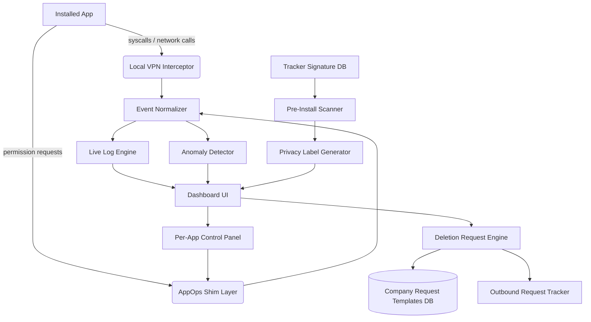

# PrivaCage — Product Vision and Completion Specification
**Goal: make the privacy behavior a device can actually expose understandable, auditable, and controllable.**

This file preserves the broad product requirements and long-term direction for PrivaCage. It is **not** a claim that every item is already implemented. The current implementation overview is in README.md; the current architecture is in docs/architecture.md; Android-specific behavior and limits are in android-app/README.md. A roadmap item may be called verified only when its source code, tests, and required platform checks support the claim.

> **Scope rule:** stock Android and iOS apps cannot universally inspect other apps' system calls, defeat encrypted DNS/tunnels, or force-disable privileged OS services. Root/system builds, managed-device APIs, custom operating systems, and approved iOS NetworkExtension entitlements are separate product tiers. A control that depends on unavailable authority stays clearly marked as blocked or platform-specific; it must never simulate success.

## Current implementation status (29 October 2026)

| Target capability | Current state | What is real today |
|---|---|---|
| Live activity log | **Partial; broad cross-app activity monitoring is not implemented.** | Optional, encrypted, bounded local DNS history for the events PrivaCage's DNS path handles. No universal syscall, sensor, clipboard, or app-API interception. |
| Pre-install privacy label | **Partial implementation.** | User-selected APK static inspection/diff: package/version/target SDK, requested permissions, exported components, hashes, signer metadata/signature integrity, and bounded DEX string matches. No execution or universal destination discovery. |
| Per-app permission toggles | **Not implemented as described.** | Launcher-visible permission declaration/grant audit and local drift comparison; changes to other apps remain OS-controlled. |
| Per-app network kill switch | **Not implemented as described.** | DNS-only VPN routes supported UDP-DNS packets addressed to its virtual IPv4/IPv6 DNS endpoints. It is not a general egress VPN or firewall. |
| Tracker database | **Implemented foundation; coverage is deliberately limited.** | Bundled, source-linked catalogue with 25 indicator records and explicit user-reviewed import. It is not a continuously updated or comprehensive global list. |
| Data deletion requests | **Local draft workflow only.** | UK GDPR/California CCPA draft generation and a user-guided DROP checklist; requests are not sent automatically and company-side deletion is not technically verified. Legal review is a release gate. |
| Consent receipt ledger | **Partial / distinct implementation.** | Optional local DNS events can be exported as redacted, hash-chained and signed checkpoints. This is not a record of every system permission grant/revoke. |
| Panic mode | **Not implemented.** | No one-tap network shutdown for all non-essential apps is available. |
| Anomaly alerts | **Not implemented as described.** | No general per-app behavior-baseline alert engine or on-device ML monitor is claimed. |
| Metadata protection | **Implemented with format limits.** | Local JPEG/PNG/WebP inspection and cleaned-copy export for recognized metadata classes; unknown chunks and identifying visual content can remain. |
| Google-service review | **Implemented in PR #20; verification pending.** | Local status inspection for three package IDs plus Android-owned app-info handoff; does not force-disable core Google packages or inspect their traffic. |
| Windows privacy hardening | **Implemented with explicit scope.** | Local audit and selected allowlisted, reversible policies; not a guarantee of zero telemetry or zero outbound traffic. |
| Web console | **Implemented catalogue console; live-device ingestion not connected.** | Svelte frontend and Rust/Axum API for tracker intelligence and local signed-checkpoint verification. It does not pretend to receive a live-device event stream. |
| iOS companion | **Design/capability notes only; executable product target not present.** | Work must use public APIs, user-provided privacy reports, and approved NetworkExtension capabilities; no cross-app binary or syscall inspection claim. |

The table is intentionally conservative. A unit test proves only the behavior it exercises; it does not prove OEM coverage, operating-system enforcement, legal effectiveness, or a complete live activity feed.

---

## Table of Contents
- [Current implementation status](#current-implementation-status-29-october-2026)
- [Target feature set and delivery status](#target-feature-set-and-delivery-status)
- [Target architecture](#target-architecture-not-a-claim-that-each-component-is-shipped)
- [Historical proposed repo structure](#original-proposed-repo-structure-historical-design-reference)
- [Target onboarding flow](#target-onboarding-flow-not-yet-shipped-as-specified)
- [Core modules](#core-modules--target-modules-and-implementation-state)
- [Live log target design](#the-live-log-system-normal--cs-mode--target-design)
- [Target data flow](#data-flow--target-pipeline-not-current-end-to-end-coverage)
- [Target tech stack](#target-tech-stack-verify-against-the-current-implementation-before-adding-modules)
- [Legal request engine](#legal-request-engine-gdprccpa--target-specification)
- [Limitations](#limitations-read-this-first)
- [Roadmap](#roadmap)
- [Additional privacy-focused ideas](#additional-privacy-focused-ideas)
- [Contributing](#contributing)
- [License](#license)

---

## Target feature set and delivery status

These are the features the product aims to deliver. The status column separates working slices from planned or platform-blocked work.

| Feature | Product requirement | Delivery status |
|---|---|---|
| **Live Activity Log** | Show observed network destinations and OS-exposed events with provenance, timestamp, reliable app attribution only, and Normal / technical-detail views. | **Partial.** Optional local DNS events exist. General syscall, sensor, clipboard and cross-app API interception is unavailable to an ordinary app. |
| **Pre-install Privacy Label** | Analyze user-selected APKs before installation: manifest/permission declarations, exported components, signer and hash evidence, known SDK indicators, and capability-versus-observation explanations. | **Partial implementation exists.** Static APK inspection and comparison are implemented; static indicators are not runtime proof. |
| **Per-app Permission Toggles** | Link to OS-owned controls on stock devices. Any elevated/AppOps integration must be an explicit root/system tier with verified results and rollback. | **Stock settings/audit only.** Cross-app mutation and fake-data injection are not implemented. |
| **Network Kill Switch (per-app)** | Build a tested full-egress policy engine before offering per-app network isolation; separate DNS blocking from all-traffic blocking and provide recovery. | **Not implemented as a full-egress kill switch.** The existing VPN routes only virtual DNS endpoints and has protocol blind spots. |
| **Tracker Database** | Maintain evidence-linked, versioned domain/SDK indicators, provenance, review freshness, diffing, and human-reviewed promotion. | **Working foundation.** 25 bundled indicators; the list is not comprehensive and is not silently refreshed/auto-enforced. |
| **Data Deletion Request Generator** | Prepare jurisdiction-aware requests with user approval, official sources, deadline tracking, receipts, and user-reported status. Any send action needs separate consent and verifiable evidence. | **Local drafts only.** No automatic request sending; legal review is required. |
| **Consent Receipt Ledger** | Record observable user-approved policy/permission changes and create redacted, exportable, tamper-evident records without claiming invisible events. | **Partial.** Signed, hash-chained DNS-history checkpoints exist; there is no universal permission grant/revoke feed. |
| **Panic Mode** | Apply only supported user-confirmed emergency policies, show per-action success/failure, and offer a recovery path. | **Not implemented.** |
| **Anomaly Alerts** | Compare available evidence against local baselines and explain why an event is unusual without claiming that novelty proves malicious behavior. | **Not implemented as a general app-behavior detector.** |

---

## Target architecture (not a claim that each component is shipped)

The following diagram records the desired data flow. Current implementation details and platform boundaries are documented in docs/architecture.md.



---

## Original proposed repo structure (historical design reference)

The tree below preserves the original concept, but several paths and frameworks no longer match the actual repository. Check README.md's repository map before creating files; the current Android project is android-app/, the shared Kotlin/JVM engine is android-core/, the web client is web/, and the Rust API is web-backend/.

```
privacage/
├── README.md
├── LICENSE
├── CONTRIBUTING.md
├── docs/
│   ├── architecture.md
│   ├── threat-model.md
│   ├── legal-basis.md              # jurisdiction-by-jurisdiction legal notes
│   └── permission-matrix.md
├── android/
│   ├── app/
│   │   ├── src/main/java/com/privacage/
│   │   │   ├── vpn/                # VpnService-based traffic interceptor
│   │   │   │   ├── PacketInspector.kt
│   │   │   │   ├── DnsBlocklistMatcher.kt
│   │   │   │   └── PerAppRuleRouter.kt
│   │   │   ├── appops/              # permission shim layer
│   │   │   │   ├── PermissionToggleService.kt
│   │   │   │   └── FakeDataInjector.kt
│   │   │   ├── scanner/            # static APK analysis
│   │   │   │   ├── ManifestParser.kt
│   │   │   │   ├── SdkSignatureMatcher.kt
│   │   │   │   └── PrivacyLabelBuilder.kt
│   │   │   ├── log/                # the live log engine (see below)
│   │   │   │   ├── EventNormalizer.kt
│   │   │   │   ├── LogFormatterNormal.kt
│   │   │   │   ├── LogFormatterVerbose.kt
│   │   │   │   └── AnomalyDetector.kt
│   │   │   ├── legal/              # GDPR/CCPA request engine
│   │   │   │   ├── RequestTemplateEngine.kt
│   │   │   │   ├── CompanyRegistry.kt
│   │   │   │   └── SubmissionTracker.kt
│   │   │   └── ui/
│   │   │       ├── DashboardActivity.kt
│   │   │       ├── AppDetailScreen.kt
│   │   │       └── PanicModeFragment.kt
│   │   └── AndroidManifest.xml
│   └── root-extensions/            # optional, root-only deeper hooks
│       ├── xposed-module/
│       └── magisk-module/
├── ios/
│   ├── PrivaCage/
│   │   ├── NetworkExtension/       # NEPacketTunnelProvider-based monitor
│   │   ├── PrivacyReport/          # uses Apple's "App Privacy Report" data
│   │   └── UI/ (SwiftUI)
│   └── README-ios-limitations.md   # what Apple's sandbox blocks you from doing
├── shared/
│   ├── tracker-db/
│   │   ├── signatures.json         # community-maintained tracker/SDK list
│   │   ├── domains-blocklist.txt
│   │   └── schema.md
│   ├── legal-templates/
│   │   ├── gdpr_article17.md
│   │   ├── ccpa_1798_105.md
│   │   └── company-contact-registry.json
│   └── go/
│       └── pcage-tools/           # Go CLI: catalog validation, review report, Android policy gates
├── backend/ (optional sync/cloud features — fully opt-in, E2E encrypted)
│   ├── api/
│   ├── requests-relay/             # proxies deletion requests, no data retention
│   └── docker-compose.yml
└── tests/
    ├── vpn/
    ├── scanner/
    └── legal-engine/
```

---

## Target onboarding flow (not yet shipped as specified)

The desired first-launch experience offers a recommended setup and an advanced setup, then an app-alternatives page. This is a product requirement, not a description of the current main screen.

```
Welcome Screen
      │
      ▼
 ┌─────────────┐        ┌─────────────┐
 │ Recommended │        │  Advanced   │
 │   (1 tap)   │        │ (full control) │
 └──────┬──────┘        └──────┬──────┘
        │                      │
        ▼                      ▼
 Applies curated         User walks through every
 default ruleset:        category manually:
 - block all known       - per-category toggle (ads,
   ad/analytics SDKs       analytics, fingerprinting,
   on sight               location, clipboard, contacts,
 - deny background        crash reporters, A/B test SDKs)
   location + clipboard  - per-app override table
 - auto-send deletion    - choose which data types get
   requests to known       auto flagged for deletion
   major data brokers      requests (location history,
 - CS-mode log OFF         ad ID, purchase history, etc.)
   by default              - choose log verbosity default
        │                      │
        └──────────┬───────────┘
                    ▼
          Recommended Apps Page
```

- **Recommended path** — one tap, applies a maintained "safe defaults" profile (same signature DB, pre-picked conservative rules). Good for non-technical users.
- **Advanced path** — a per-category and per-app configuration screen (`SetupWizardActivity.kt` / `AdvancedConfigScreen.kt`) where the user picks exactly what gets blocked, faked, allowed, or auto-flagged for a deletion request, and sets default log verbosity (Normal/CS).
- Both paths are editable later from Settings → Privacy Rules — nothing here is a one-time irreversible choice.

### Recommended Apps Page
Shown once setup finishes (and always reachable later from the Dashboard). A curated, community-reviewed directory of privacy-respecting alternatives to common mainstream apps, grouped by category, with a one-line reason and a direct install link (F-Droid / Play Store / App Store / direct APK where relevant).

Organized to roughly mirror the Google/Big-Tech app suite, so a user can swap out their whole daily stack one category at a time.

| Category | Google/Big-Tech equivalent | Recommended | Why |
|---|---|---|---|
| Email | Gmail | **Proton Mail**, Tutanota | E2E encrypted, no ad-based scanning of content |
| Cloud storage | Google Drive / iCloud | **Proton Drive**, Cryptomator (+ any storage) | Zero-access encryption — provider can't read your files |
| Calendar | Google Calendar | **Proton Calendar**, Etar (local) | E2E encrypted or fully local, no ad profiling |
| Password manager | Chrome autofill / Google Password Manager | **Proton Pass**, Bitwarden, KeePassXC | Open-source clients, E2E encrypted vaults |
| Browser | Chrome | **Brave**, Firefox (hardened), Mull | Built-in tracker/fingerprint blocking, no Google telemetry pipeline |
| Search | Google Search | **Startpage**, DuckDuckGo, SearXNG (self-host) | No query-to-identity logging |
| Messaging | Google Messages / WhatsApp | **Signal**, SimpleX Chat, **Telegram*** | Signal = E2E by default + minimal metadata; SimpleX = no phone number required; *Telegram chats are NOT E2E encrypted by default — only "Secret Chats" are, so it's listed as a convenience option, not a privacy-first pick |
| Video calls | Google Meet / Zoom | **Jitsi Meet**, Signal calls | No account required (Jitsi), E2E (Signal) |
| Notes | Google Keep | **Standard Notes**, Joplin | E2E encrypted or fully local-first |
| Office/docs | Google Docs/Sheets/Slides | **Proton Docs**, CryptPad, LibreOffice (local) | Encrypted collaborative editing or fully offline |
| Maps | Google Maps | **OrganicMaps**, OsmAnd | No location telemetry sent anywhere, offline-first |
| App store | Google Play | **F-Droid**, Aurora Store (anonymized Play access) | F-Droid = open-source-only, no tracking SDKs; Aurora = anonymous Play downloads without a Google account |
| DNS/ad-block | Google Public DNS | **NextDNS**, AdGuard DNS | Configurable tracker/ad blocking at the resolver level |
| OS | Stock Android / manufacturer skins | **GrapheneOS**, CalyxOS | Strips Google services layer, hardened sandboxing — pairs with this app's root-extension module |
| Keyboard | Gboard | **FlorisBoard**, AnySoftKeyboard | No cloud-synced keystroke logging |
| Launcher | Stock/OEM launcher | **Lawnchair**, Niagara | No usage telemetry baked in |
| Photos/gallery backup | Google Photos | **Ente Photos**, Stingle Photos | E2E encrypted cloud backup |
| File sync | Google Drive sync | **Syncthing** | Peer-to-peer, no cloud middleman at all |
| 2FA/authenticator | Google Authenticator | **Aegis Authenticator**, Raivo | Local-only, encrypted export, no cloud account requirement |
| RSS/news | Google News | **Feeder**, Newsflash | No reading-habit profiling |
| Voice assistant | Google Assistant | **Mycroft** (self-host) | No cloud voice-data retention by a third party |
| Analytics/crash reporting (for devs) | Firebase Analytics/Crashlytics | **Matomo** (self-host), **Sentry** (self-host option) | You own the data, no vendor resale |
| Ad blocking (system-wide) | — | **AdGuard**, Blokada | DNS/VPN-level blocking across all apps |
| Social/microblogging | Twitter/X | **Mastodon**, Bluesky (limited) | Federated/no centralized ad-profiling model (Mastodon) |
| Video hosting/viewing | YouTube | **PeerTube** (hosting), **NewPipe**/FreeTube (viewing without Google account/tracking) | No watch-history-to-ads pipeline |
| Backup | Google Backup | **Seedvault** (GrapheneOS-native) | Fully local/encrypted device backup, no cloud vendor |
| Contacts sync | Google Contacts | **Nextcloud Contacts**, Proton (via CardDAV) | Self-hosted or zero-access sync |
| Weather | Google Weather | **Breezy Weather** | No background location telemetry to an ad network |
| Translation | Google Translate | **LibreTranslate** (self-host) | No text sent to a third-party ad-funded service |

> \* Apps marked with an asterisk are included because they're extremely widely used and a realistic stepping stone, **not** because they meet the project's privacy bar outright — the Privacy Label system (above) is applied to every entry here too, so the directory shows the honest tradeoffs instead of pretending everything listed is equally private.

### Trust & Vetting Process for New Entries
Because a privacy tool recommending *other* apps is a prime target for someone sneaking in a bad-faith listing, every addition to `recommended-apps.json` goes through a fixed review gate before merge — this isn't optional for contributors:

1. **Minimum evidence bar** — PR must cite: open-source status (link to repo) or a published third-party audit, data handling policy, and jurisdiction. No evidence = auto-rejected by the PR template checklist.
2. **Automated signature scan** — the app's APK/IPA (if obtainable) gets run through the same `SdkSignatureMatcher` used for the pre-install scanner. If it contains known tracker/ad SDKs, it's auto-labeled "convenience pick, not privacy-first" (like Telegram above) rather than silently approved.
3. **Two-maintainer sign-off** — no single contributor (including the repo owner) can merge a new entry solo; requires two independent maintainer approvals, logged in the PR.
4. **Re-audit cadence (planned)** — future review automation may compare user-selected or explicitly supplied app versions against the curated tracker database. The current Go tooling validates catalog structure and review dates; no automated app download, APK re-scan schedule, or auto-generated regression issue is implemented.
5. **Revocation path** — any maintainer can open a "delist" issue with evidence (policy change, acquisition by an ad company, leaked audit failure); delisting requires one maintainer approval (lower bar than adding, intentionally — removing a bad recommendation should be fast).
6. **No paid placement, ever** — `CONTRIBUTING.md` explicitly bans sponsored/paid entries; the list order within a category is alphabetical, never ranked by anything resembling a bid.
7. **Full changelog** — every add/remove/re-label is tracked in `shared/recommended-apps-CHANGELOG.md` so users can see exactly when and why an app's status changed.

Implementation-wise this page is just a static/community-updatable JSON (`shared/recommended-apps.json`) rendered into a card list (`RecommendedAppsScreen.kt` / SwiftUI equivalent) — same update pipeline as the tracker signature DB, so the list can grow via PR without an app update.

```json
// shared/recommended-apps.json (excerpt)
{
  "email": [
    { "name": "Proton Mail", "reason": "E2E encrypted, Swiss jurisdiction", "links": { "android": "https://play.google.com/store/apps/details?id=ch.protonmail.android", "ios": "https://apps.apple.com/app/id979659905", "fdroid": null } }
  ],
  "vpn": [
    { "name": "Proton VPN", "reason": "No-logs, audited, open-source clients", "links": { "android": "...", "ios": "..." } }
  ]
}
```

---

## Core Modules — target modules and implementation state

The module names below describe desired responsibilities and include historical paths. They are not proof that every named module or screen exists in the current tree. See the status table above and the current repository map before implementing changes.

### 1. Permission Scanner
Parses an APK's manifest + bytecode before install. Cross-references against the tracker signature DB. Outputs a structured "privacy label": what it *can* access, what SDKs are embedded, what domains it talks to.

### 2. Live Monitor (VPN-based)
Routes all device traffic through a local loopback VPN interface (no data leaves the device — this is a self-tunnel, not a real VPN provider). Every connection gets tagged with the requesting app's UID, inspected against the blocklist, logged, and either passed or dropped per the user's per-app rules.

### 3. AppOps Shim
Sits on top of Android's existing permission system to allow finer control than the OS exposes by default (e.g., "give fake GPS coordinates" instead of a hard permission denial that might crash the app).

### 4. Anomaly Detector
Builds a rolling behavioral baseline per app and flags deviations — new domains contacted, new permission usage patterns, unusual time-of-day activity.

### 5. Legal Request Engine
Not a magic deletion button — it **drafts and sends** a properly formatted legal request under the relevant law (GDPR/CCPA/etc.) to the company's registered privacy contact, then tracks the response/SLA window. Actual deletion is the company's legal obligation, not something the app can force technically.

---

## The Live Log System (Normal & CS mode) — target design

The Normal/CS two-mode live log is a future product requirement. The current optional DNS event history has narrower coverage and must not be described as a general device activity log.

This is the centerpiece feature you asked about — a real-time feed of what every app is doing, in two toggleable verbosity modes.

### Normal Mode (for everyday users)
```
[14:32:07] Instagram — sent your approximate location to ads.instagram.com
[14:32:11] Spotify — read your clipboard (copied text: "a1b2c3...")
[14:32:19] 🔴 TikTok — tried to access your contacts list (blocked — you denied this)
[14:33:02] WeatherApp — checked GPS location (allowed, used for forecast)
[14:33:45] ⚠️ Flashlight App — connected to an unknown ad server you've never allowed before
```

### CS Yap Mode (verbose/technical, for power users & devs)
```
[1699999927.114] PID=14223 UID=10187 pkg=com.instagram.android
  SYSCALL=connect() → 157.240.22.35:443 (TLS SNI: ads.instagram.com)
  MATCHED_SIGNATURE: tracker_db#META_ADS_SDK_v3 (confidence=0.97)
  LOCATION_API: FusedLocationProviderClient.getLastLocation() → lat=±500m accuracy, cached@14:29:58
  ACTION: PASSTHROUGH (user_rule=ALLOW_NETWORK, no explicit block on this endpoint)

[1699999931.558] PID=9981 UID=10052 pkg=com.spotify.music
  API_HOOK: ClipboardManager$getPrimaryClip() invoked from background (app not in foreground, RESUMED=false)
  CLIP_HASH=sha256:9f86d0...  (content redacted per local privacy policy)
  FLAG: BACKGROUND_CLIPBOARD_ACCESS — elevated risk, logged to anomaly table

[1699999939.201] PID=22110 UID=10290 pkg=com.zhiliaoapp.musically
  APPOPS_CHECK: OP_READ_CONTACTS → MODE_IGNORED (user override, appops.db rule_id=4471)
  RESULT: SecurityException synthetically raised, caller received empty Cursor (no crash fallback engaged)

[1699999982.447] PID=5541 UID=10401 pkg=com.flashlight.freeled
  DNS_QUERY: a.mediaservedomain.io → NOT in known_tracker_db (zero prior hits across 4,812 scanned sessions)
  ANOMALY_SCORE: 0.88 (new domain + outside established baseline window 08:00–22:00 local)
  ACTION: FLAGGED_FOR_REVIEW, network call passed through pending user decision
```

Users toggle between modes with a single switch in Settings → Logging → Verbosity. CS mode is rate-limited/paginated since it generates a *lot* more output — meant for debugging/auditing, not casual scrolling.

Both modes write to the same underlying structured event store; the formatters are just two different renderers (`LogFormatterNormal.kt` / `LogFormatterVerbose.kt`) reading the same `EventNormalizer` output, so nothing is lost by using Normal mode day-to-day — you can always re-render history in CS mode later.

---

## Data Flow — target pipeline, not current end-to-end coverage

1. App does something (network call, permission check, sensor read)
2. VPN interceptor or AppOps shim catches it
3. Event gets normalized into a common schema: `{timestamp, pid, uid, package, action_type, target, decision, matched_signature}`
4. Event is written to local log store (SQLite, append-only, optionally encrypted at rest)
5. Dashboard subscribes to the log store and renders live, per either verbosity mode
6. Anomaly detector runs async on each new event against that app's rolling baseline
7. If user sets a rule (block/allow/fake-data), it's pushed back down to the VPN/AppOps layer immediately

---

## Target Tech Stack (verify against the current implementation before adding modules)

The existing Android main screen currently uses Android Views, not the Compose screens proposed below. Shared implementation uses Kotlin/JVM, Rust and Go tools; the web workspace uses Svelte/TypeScript with a Rust/Axum API. iOS is not yet an executable target. Prefer real repository modules over recreating this earlier proposal.

| Layer | Android | iOS |
|---|---|---|
| Network interception | `VpnService` (local loopback tunnel) | `NetworkExtension` (`NEPacketTunnelProvider`) — more restricted by Apple |
| Permission control | `AppOpsManager` (shim, root optional for full range) | Apple's native per-permission toggles only — no shim possible without jailbreak |
| Static scanning | Custom manifest + dex analysis (Kotlin) | Can't scan other apps' binaries pre-install on iOS at all — App Store sandboxing blocks this entirely; limited to **your own** app's declared data via Apple's Privacy Nutrition Labels/App Privacy Report |
| Local storage | SQLite (Room) | SQLite (Core Data / GRDB) |
| UI | Jetpack Compose | SwiftUI |
| Tracker DB checks and reports | Go standard-library CLI + GitHub Actions | same, shared repo |
| Optional backend | Go/Python API, Docker | same |

---

## Legal Request Engine (GDPR/CCPA) — target specification

The current Android workflow prepares local, user-reviewed drafts and a user-guided DROP checklist; it does not send requests. Do not assume a generic deadline or citation is current for every jurisdiction and request type. Each template needs up-to-date official sources and qualified legal review.

The intended module should:

- Map the company/controller, jurisdiction, request type, and applicability to current official guidance.
- Draft an access, deletion, correction, portability, or opt-out request with source links and clear eligibility/exception notes.
- Let the user review and explicitly approve the exact recipient, identity details, and outbound content before any submission integration.
- Track only metadata needed for follow-up: request type, recipient, sent/receipt date if user-confirmed, deadline calculated from verified law, and user-reported outcome. Do not store document contents or identity data by default.
- Never claim that a request was sent without verifiable send/receipt evidence, or that a company deleted data without reliable confirmation.
- Include opt-out automation only where a supported, documented, user-authorized flow exists; maintain a human fallback for CAPTCHA, identity proof, and ambiguous eligibility.

---

## Limitations (read this first)

- **Manufacturer/OEM/carrier telemetry** (baseband firmware, bundled system apps, Google Play services on stock Android) is outside an ordinary app's authority. PrivaCage can inspect a few exposed settings and hand off to OS-owned controls; it cannot force-disable protected services, replace the operating system, or promise that changing a setting removes all telemetry.
- **Google service status is not traffic evidence.** Package presence/version/enabled state does not prove collection or data transfer. App-info handoff only opens Android-owned UI; Android decides which controls are available. Core service changes can break device and app functionality.
- **DNS filtering is not a universal firewall.** A DNS-only VPN does not inspect arbitrary HTTPS or automatically block DoH/DoQ, direct IPs, other tunnels, or every application network path. IPv6 handling is confined to the implemented virtual-DNS path.
- **Manufacturer/OEM/carrier-level telemetry** (baseband firmware, bundled system apps, Google Play Services on stock Android) runs at a privilege level this app cannot touch without root + a custom ROM (GrapheneOS, CalyxOS, etc.). PrivaCage can advise you to switch ROMs — it can't do it for you.
- **iOS is fundamentally more locked down.** No app can inspect another app's binary, intercept its syscalls, or override its permissions beyond Apple's own Settings toggles. The iOS build is mostly a dashboard over Apple's existing Privacy Report + the legal request engine.
- **Deletion requests are legal instruments, not technical ones.** This app cannot reach into a company's database and delete rows — compliance is the company's legal obligation, enforced by regulators, not by this app.
- **Root-based features void warranties and increase attack surface.** Clearly gated behind an explicit, scary warning in-app.

---

## Roadmap — desired outcomes, not implementation claims

This list is the next delivery queue, not a promise that a milestone can bypass its required platform/legal check.

- [ ] Recommended/advanced setup wizard that previews every rule and leaves the user in control.
- [x] App-alternative directory and local sequential source queue. **Remaining:** per-entry source review and improved onboarding.
- [ ] Full-egress network protection only after protocol coverage, lifecycle, leak behavior, consent, fail-closed behavior, and recovery can be verified. The current tunnel is DNS-only.
- [ ] Normal/CS log UI from typed, real observations; each item must say whether evidence is OS-observed, DNS-observed, static, user-reported, inferred, or unavailable.
- [x] User-selected APK static inspection and comparison. **Remaining:** more hostile-input tests and better explanation; no execution/runtime claim.
- [ ] Stock permission-control handoffs and, separately, a researched root/system integration with verified results and rollback.
- [ ] Optional root/system extension as an isolated project with threat model, device compatibility, uninstall/recovery, and reproducible tests.
- [x] Local UK GDPR / California CCPA request drafts and a user-guided DROP checklist. **Remaining:** qualified legal review, current template sources, and any separately authorized submission integration.
- [ ] Add jurisdictions only after official-source verification and legal review of exemptions, identity verification, deadlines, and appeals.
- [ ] iOS target only after the exact public-API/NetworkExtension approach and entitlement/distribution requirements are feasible.
- [x] Evidence-backed tracker catalogue and review workflow. **Remaining:** wider evidence-backed coverage, per-entry freshness, source/license governance, and human review before promotion.
- [ ] Anomaly alerts from observable local evidence only; distinguish novelty from wrongdoing and show the reason for each alert.
- [ ] Device privacy change timeline from exposed settings and user-confirmed changes, not facts outside app visibility.
- [ ] Stalkerware/coercive-monitoring checks based on OS-exposed indicators, with safety review and false-positive handling.
- [ ] Offline breach-exposure matching using a trusted, versioned local dataset without uploading the user's identifier.
- [ ] Data-broker opt-out checklists, source-backed forms, and reminders with user control of identity details and submission.
- [ ] PDF/Office metadata cleaning after bounded parser implementation, format-specific regression fixtures and output verification.
- [ ] IoT/router evidence import with explicit authorization, rather than implying a phone-only VPN sees an entire local network.
- [ ] Release gate for telemetry inventory, input bounds, secret scanning, rollback, source provenance, accessibility, and claim-vs-code documentation parity.

Status vocabulary: **Planned** means no implementation claim; **partial** means a bounded slice exists; **implemented, verification pending** means source/tests exist but required checks have not passed on the exact head; **verified** means the named checks/platform evidence passed on that exact commit; **blocked externally** means required device, entitlement, operator, or legal review is unavailable.

---

## Additional privacy-focused ideas

These extend the original vision. Each is a separate, evidence-gated feature; none should be advertised until its own implementation and tests exist.

| Idea | Feasibility | Minimum honest implementation |
|---|---|---|
| **Stalkerware / coercive-monitoring checks** | Partial checks are possible on stock Android; comprehensive detection is not. | Audit user-visible accessibility services, device-admin apps, notification-listener access and active VPN role only where Android exposes them. Explain each observation and confidence; never label a person or app abusive based on one signal. Keep root-only indicators separate. |
| **Offline breach exposure check** | Buildable if a trusted, versioned dataset can be distributed safely. | Prefer local hash matching or a k-anonymity-compatible hash-prefix protocol. Do not send full emails or identifiers to an arbitrary breach API. Include dataset date/provenance and explain that no match proves nothing about unlisted breaches. |
| **Data-broker opt-out helper** | Partially buildable; individual broker flows and identity checks vary. | Add official opt-out links, a user-reviewed checklist and local reminders to the rights-request engine. No automated submission without a documented, user-authorized mechanism; avoid storing identity documents. |
| **Photo/document metadata protection** | Buildable per format with bounded parsers and output verification. | Continue JPEG/PNG/WebP, then add PDF/Office metadata only after format-specific parsing tests. Preserve originals and explain unsupported fields; visible pixels/text can still reveal identity or location. |
| **Ad-ID and permission hygiene** | Reminders and OS settings handoffs are buildable; automatic rotation/revocation is platform-dependent. | Show only OS-exposed state, link to official controls, and offer local reminders. Never claim to reset an ID or revoke another app's permissions without a real OS-confirmed result. |
| **Cross-app SDK and tracker dependency review** | Static APK comparison is buildable; live cross-app runtime proof is not available on stock devices. | Compare APK hashes and catalogue revisions, explain each SDK/domain indicator, and keep static strings distinct from observed traffic. |
| **Local network / IoT inventory** | Needs explicit local-network authorization; traffic attribution requires router/resolver evidence. | Start with a consented inventory and vendor-identification uncertainty. Do not scan networks without authorization or claim a phone-only VPN observes every LAN device's traffic. |
| **Browser fingerprinting privacy** | Limited from a companion app. | Offer browser-specific configuration guidance and explain that blocking cookies does not defeat fingerprinting. Randomization would belong inside a controlled browser/WebView and requires measurement for breakage; PrivaCage cannot change unrelated browsers. |
| **Smart-TV / IoT telemetry review** | Requires vendor documentation or authorized network evidence. | Provide sourced per-vendor settings checklists and optional local import of user-provided router logs. Do not imply the phone can inspect every TV/IoT connection. |
| **Privacy evidence and change alerts** | Buildable for facts PrivaCage owns or OS APIs expose. | Compare local permission baselines, selected APK versions, DNS rule changes and signed checkpoints. Each alert states before/after values, source and confidence; no opaque universal privacy score. |

### More privacy by default

- Keep network activity local; product telemetry, analytics SDKs, remote fonts and automatic report upload stay absent unless the user explicitly opts into a documented feature.
- Default logs to off or minimum detail, use bounded retention, encrypt retained sensitive history, redact hostnames and app attribution in exports, and include clear delete/export/reset controls.
- Prefer local-first processing. Any remote lookup discloses exactly what is sent, to whom, and retention before the user consents.
- Use signed, versioned catalogue updates with provenance and reproducible diffs. Downloaded candidates never become active rules without review.
- Maintain an explicit capability matrix for stock Android, root/system Android, custom OS, iOS, web, and Windows. Each UI action reports success or the precise error from its real backend/OS.
- Threat-model stalker/coercive-control risk: avoid unsafe notifications and never promise safe removal without considering the user's circumstances.
- Add release checks for accidental telemetry, broad package visibility, plaintext sensitive logs, unbounded inputs, unsafe external URLs, missing rollback, and misleading capability claims.

---

## Contributing

PRs welcome, especially for:
- New entries in `shared/tracker-db/signatures.json` (with source/evidence)
- Jurisdiction templates in `shared/legal-templates/`
- OEM-specific telemetry documentation (what exactly phone X sends home)

See `CONTRIBUTING.md` for the signature-submission format and review process.

---

## License

MIT — because a privacy tool should never be a walled garden itself.
